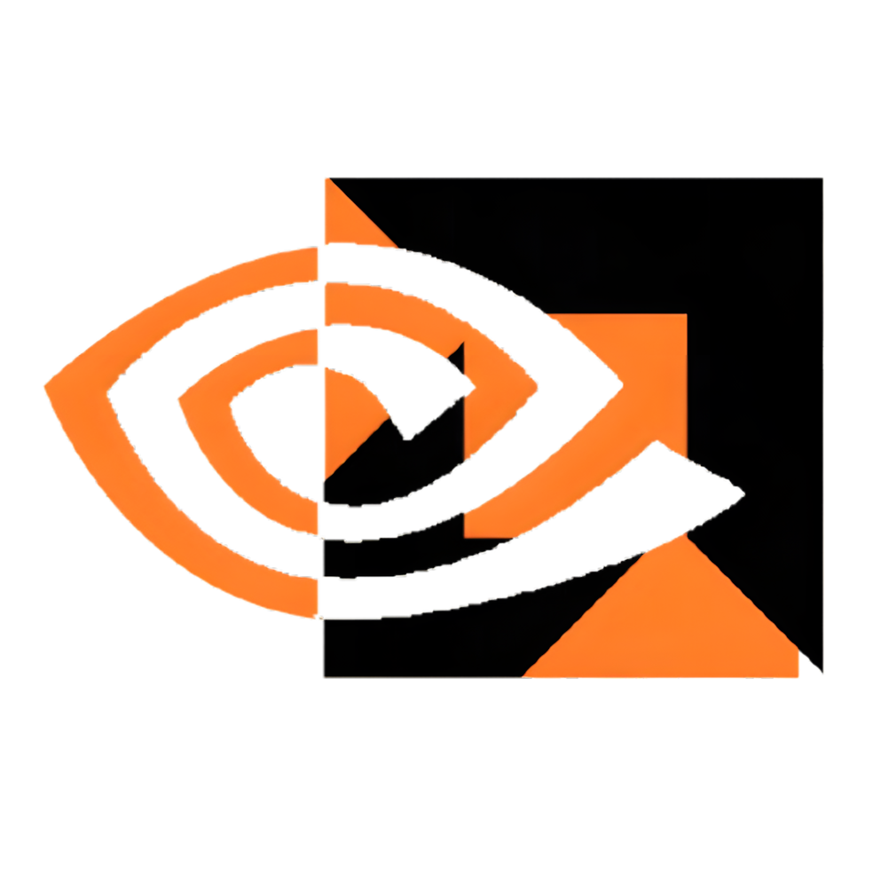
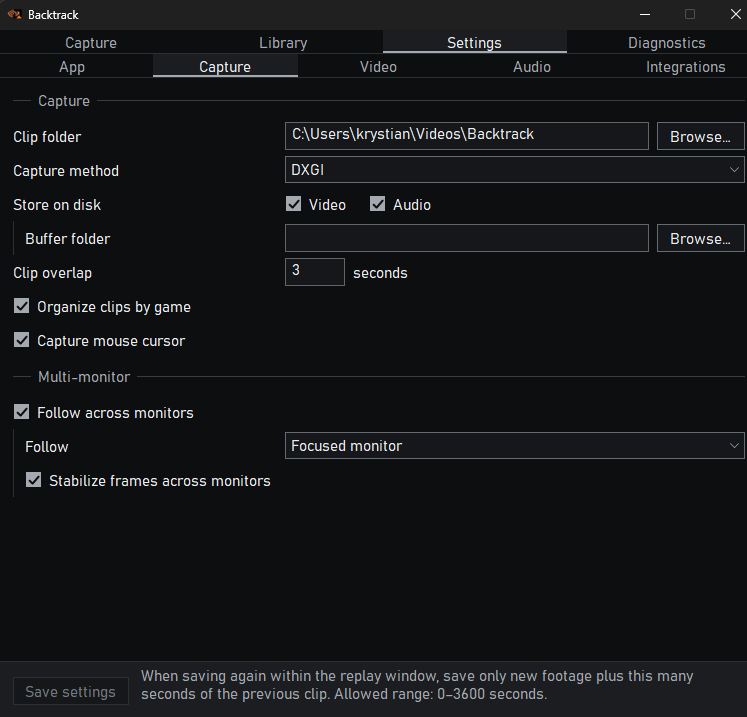

<div align="center">
  
</div>

# backtrack
lightweight clipping software that works with both nvidia (nvenc) and amd (amf).<br>

<div align="center">
  
</div>

## amd
i dont use amd, some features might not work. dont expect much

## features
- voice commands
- customization of the gpu/encoding settings
- multi-monitor support
- library
- sound separation (you can disable sound from specific apps)
- cool icon
- game integrations (only lol)
- discord rpc

## defaults

- Start/stop recording: `Ctrl+Alt+F9`
- Save replay: `Ctrl+Alt+F10`
- Clips: `%USERPROFILE%\Videos\Backtrack`
- Settings/logs: `%LOCALAPPDATA%\Backtrack`

## terms of use
By using this project or its source code, for any purpose, you grant your implicit agreement to all the following statements:
- you love hazbin hotel
- you jerk off to character.ai
- you're diagnosed with nihilism
- You're conscious of how wealthy elites, billionaires, powerful corporations, and government exploit ordinary people to preserve and expand their wealth, authority, and influence. You understand how economic systems, corporate monopolies, and the concentration of resources can be used to maintain power while limiting individual freedom, financial independence, and opportunities for the average person. You're aware of how mainstream media can influence public perception through censorship, selective reporting, propaganda and algorithmic manipulation. You actively question who benefits from the current system, how public opinion is shaped, and how economic dependence, political influence, and information control can restrict people's ability to think independently, make informed decisions, and exercise genuine autonomy.

## Repository Layout

```text
backtrack/src/app            Application and recorder orchestration, video timeline scheduler
backtrack/src/audio          WASAPI loopback and microphone capture
backtrack/src/capture        WGC, Desktop Duplication, D3D11 device setup, GPU frame scaler
backtrack/src/clips          Clip listing, rename, delete, favorite markers
backtrack/src/core           Shared types, logging, lock-free SPSC queue
backtrack/src/encoder        Encoder interface, NVENC + AMD AMF implementations, vendor auto-detect factory
backtrack/src/hotkeys        Global recording/replay hotkeys
backtrack/src/integrations   Discord Rich Presence, League of Legends Live Client Data polling
backtrack/src/mux            WAV writing and native MP4 muxing
backtrack/src/platform       Win32 utility helpers
backtrack/src/replay         Encoded packet replay ring buffer
backtrack/src/settings       Lightweight persisted settings
backtrack/src/ui             Native Windows UI
backtrack/src/voice          SAPI voice commands
backtrack/src/Interface      NVENC headers and bundled AMD AMF headers
backtrack/src/third_party    Vendored RNNoise (optional noise suppression)
backtrack/tests              Console unit suites registered with CTest
```

## Dependencies

Required:

- Windows 10/11 SDK
- Visual Studio C++ toolchain with C++20
- The C++ ATL component of the installed MSVC toolset: the app includes `<sapi.h>` for voice commands and its `sphelper.h` pulls in `<atlbase.h>`. Without ATL the app fails with `C1083 atlbase.h not found`.
- A hardware encoder: NVIDIA NVENC-capable GPU or AMD AMF-capable GPU (Radeon/Ryzen APU)

Encoder backend is auto-detected from the active GPU vendor at runtime:

- NVIDIA adapters use NVENC (`nvEncodeAPI64.dll`, shipped with the NVIDIA driver).
- AMD adapters use AMF (`amfrt64.dll`, shipped with the AMD Adrenalin driver).
- On other adapters the app defaults to NVENC.

Optional at compile time:

- NVENC headers (`backtrack/src/Interface/nvEncodeAPI.h`, NVIDIA Video Codec SDK 13.0) are vendored, so NVENC builds out of the box. The same SDK one major version older (`nvEncodeAPI_11_1.h`) is vendored beside it: the app picks whichever tier the installed driver implements, so drivers that predate NVENC API 13.0 still record. If the headers are absent the build sets `BACKTRACK_HAS_NVENC=0`.
- AMD AMF headers are bundled in `backtrack/src/Interface/AMF` (Apache/MIT, headers only), so AMF builds out of the box. Set the `AMF_SDK_PATH` environment variable to the AMF SDK root (the copy must contain `amf/public/include/AMF/core/Factory.h`) to build against a different version.
- If a backend's headers are absent, the app still builds and the Diagnostics page reports why that backend is unavailable. Neither SDK ships a link-time library; both runtimes are loaded dynamically from the installed driver.

Vendored third-party:

- [RNNoise](https://github.com/xiph/rnnoise) (BSD-3-Clause) under `backtrack/src/third_party/rnnoise`, used by the optional microphone noise suppression feature. See `backtrack/src/third_party/rnnoise/README.md` for provenance, model generation, and the single local patch.

## Build

CMake, from a shell with the MSVC environment (`vcvars64.bat` or an x64 Native Tools prompt; a bare shell has no `cl` and cannot find the standard library headers):

```powershell
cmake -S . -B build -G "Ninja Multi-Config"
cmake --build build --config Release --parallel
```

This generator works with any installed MSVC and keeps the `build/Release/` output layout. Delete `build/` before switching generators; the cache records absolute paths.

Visual Studio solution, for installations that have the `v143` toolset (`backtrack.vcxproj` pins it, and VS 2026 does not ship it):

```powershell
MSBuild.exe backtrack.slnx /p:Configuration=Release /p:Platform=x64 /m
```

Microphone noise suppression is off by default. Add `-DBACKTRACK_NOISE_SUPPRESSION=ON` to the CMake configure line, or build the solution with `/p:BacktrackNoiseSuppression=true`, to compile it in. The Settings page then grows a checkbox for it.

The bundled NVENC headers in `backtrack/src/Interface` are used unless `NV_CODEC_SDK_PATH` names an SDK root (the directory holding `Interface/nvEncodeAPI.h`). A named SDK takes precedence over the bundled copy:

```powershell
$env:NV_CODEC_SDK_PATH = 'C:\Path\To\Video_Codec_SDK'
```

The CMake Release executable is produced at:

```text
build/Release/Backtrack.exe
```

The Visual Studio project Release executable is produced at:

```text
x64/Release/backtrack.exe
```

## Tests

Unit tests live in `backtrack/tests` and are registered with CTest by the root `CMakeLists.txt`. The solution has no test targets, so use CMake:

```powershell
cmake -S . -B build -G "Ninja Multi-Config"
cmake --build build --config Release --parallel
ctest --test-dir build -C Release
```

34 suites always build. `NvencLifecycleTests` and `AmfEncoderTests` are added when the NVENC and AMF headers are found (both are vendored), and `AudioDenoiseTests` when noise suppression is enabled. What each suite covers is listed in `backtrack/tests/AGENTS.md`.

The recording and replay hotkeys are configurable in Settings. The clip folder is configurable in the Capture settings. Audio devices, sound separation, resolution, encoder tuning, GPU protection, and game integrations are all configured in the Settings page.

clip overlap is configurable as the last setting in Settings → Capture. it defaults to 3 seconds: consecutive saves include new footage plus overlap from the previous clip, aligned to a keyframe. 0 removes intentional overlap; it does not force full-length replays.

## Notes

the active implementation uses direct3d 11 because nvenc can directly register d3d11 textures. wgc always outputs bgra; desktop duplication adopts the duplication surface format (bgra normally, r10g10b10a2 / scRGB on hdr desktops, tone-mapped to sdr by the gpu scaler). frames are copied gpu-to-gpu into a small texture pool (or passed through directly when wgc zero-copy is enabled) before being registered/mapped by the encoder. a gpu scaler converts each frame to the active encoder's preferred format (bgra for nvenc, nv12 for amf). output is 8-bit bt.709 sdr. only the compressed h.264/hevc bitstream is copied back to cpu memory.
