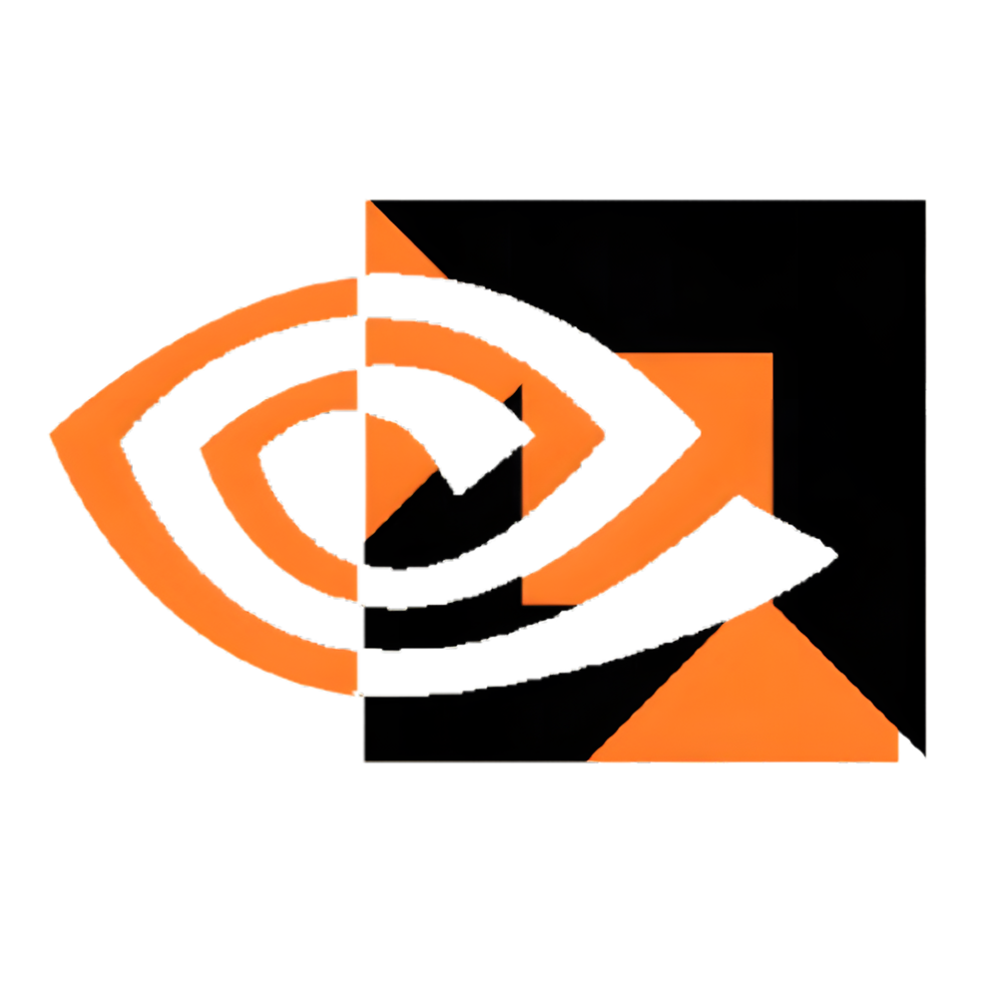
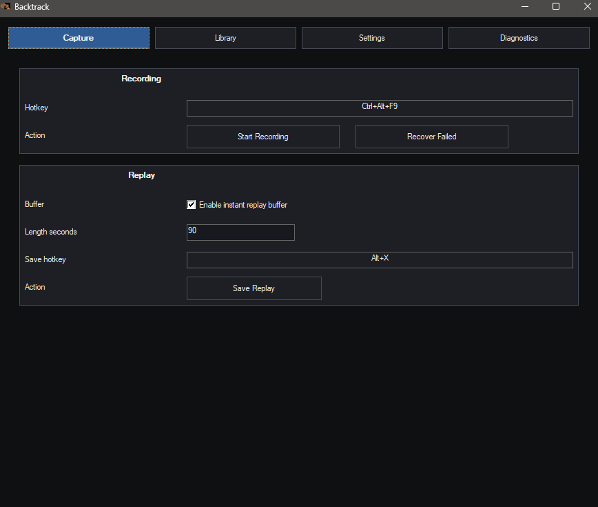

<div align="center">
  
</div>

# backtrack
lightweight clipping software that works with both nvidia (nvenc) and amd (amf).<br>

<div align="center">
  
</div>

## amd
i dont use amd, some features might not work. dont expect much

## features
- voice commands
- customization of the gpu/encoding settigns
- multi-monitor support
- library
- sound separation (you can disable sound from specific apps)
- cool icon
- game integrations (only lol)
- discord rpc
- voice commands

## defaults

- Start/stop recording: `Ctrl+Alt+F9`
- Save replay: `Ctrl+Alt+F10`
- Clips: `%USERPROFILE%\Videos\Backtrack`
- Settings/logs: `%LOCALAPPDATA%\Backtrack`

## Repository Layout

```text
backtrack/src/app            Application and recorder orchestration, video timeline scheduler
backtrack/src/audio          WASAPI loopback and microphone capture
backtrack/src/capture        WGC, Desktop Duplication, D3D11 device setup, GPU frame scaler
backtrack/src/clips          Clip listing, rename, delete, favorite markers
backtrack/src/core           Shared types, logging, lock-free SPSC queue
backtrack/src/encoder        Encoder interface, NVENC + AMD AMF implementations, vendor auto-detect factory
backtrack/src/hotkeys        Global recording/replay hotkeys
backtrack/src/integrations   League of Legends Live Client Data polling
backtrack/src/mux            WAV writing and native MP4 muxing
backtrack/src/platform       Win32 utility helpers
backtrack/src/replay         Encoded packet replay ring buffer
backtrack/src/settings       Lightweight persisted settings
backtrack/src/ui             Native Windows UI
backtrack/src/Interface      NVENC headers and bundled AMD AMF headers
backtrack/tests              Video timeline scheduler unit tests
```

## Dependencies

Required:

- Windows 10/11 SDK
- Visual Studio C++ toolchain with C++20
- A hardware encoder: NVIDIA NVENC-capable GPU or AMD AMF-capable GPU (Radeon/Ryzen APU)

Encoder backend is auto-detected from the active GPU vendor at runtime:

- NVIDIA adapters use NVENC (`nvEncodeAPI64.dll`, shipped with the NVIDIA driver).
- AMD adapters use AMF (`amfrt64.dll`, shipped with the AMD Adrenalin driver).
- On other adapters the app defaults to NVENC.

Optional at compile time:

- NVENC headers (`Interface/nvEncodeAPI.h`, NVIDIA Video Codec SDK). If missing, NVENC is disabled at build time (`BACKTRACK_HAS_NVENC=0`).
- AMD AMF headers are bundled in `backtrack/src/Interface/AMF` (Apache/MIT, headers only), so AMF builds out of the box. Set `AMF_SDK_PATH` to point at a different copy if needed.
- If a backend's headers are absent, the app still builds and the Diagnostics page reports why that backend is unavailable. Neither SDK ships a link-time library; both runtimes are loaded dynamically from the installed driver.

Vendored third-party:

- [RNNoise](https://github.com/xiph/rnnoise) (BSD-3-Clause) under `backtrack/src/third_party/rnnoise`, used by the optional microphone noise suppression feature. See `backtrack/src/third_party/rnnoise/README.md` for provenance, model generation, and the single local patch.

## Build

Visual Studio solution:

```powershell
MSBuild.exe Backtrack.slnx /p:Configuration=Release /p:Platform=x64 /m
```

CMake:

```powershell
cmake -S . -B build -G "Visual Studio 18 2026" -A x64
cmake --build build --config Release --parallel
```

If the Video Codec SDK is not installed in a standard location, set:

```powershell
$env:NV_CODEC_SDK_PATH = 'C:\Path\To\Video_Codec_SDK'
```

The CMake Release executable is produced at:

```text
build/Release/Backtrack.exe
```

The Visual Studio project Release executable is produced at:

```text
x64/Release/backtrack.exe
```

## Tests

Unit tests for the video timeline scheduler live in `backtrack/tests/VideoTimelineSchedulerTests.cpp`. The scheduler is header-only (`app/VideoTimelineScheduler.h`), so the test compiles standalone:

```powershell
cl /std:c++20 /EHsc /I backtrack\src backtrack\tests\VideoTimelineSchedulerTests.cpp
.\VideoTimelineSchedulerTests.exe
```

The recording and replay hotkeys are configurable in Settings. The clip folder is configurable in the Capture settings. Audio devices, sound separation, resolution, encoder tuning, GPU protection, and game integrations are all configured in the Settings page.

## Notes

The active implementation uses Direct3D 11 because NVENC can directly register D3D11 textures. WGC and Desktop Duplication both output BGRA D3D11 textures, which are copied GPU-to-GPU into a small texture pool (or passed through directly when WGC zero-copy is enabled) before being registered/mapped by the encoder. A GPU scaler converts each frame to the active encoder's preferred format (BGRA for both NVENC and AMF). Only the compressed H.264/HEVC bitstream is copied back to CPU memory.
